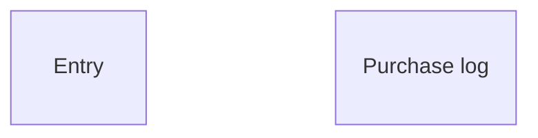
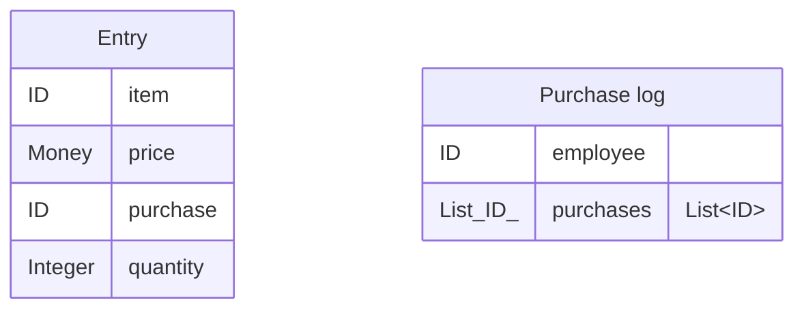

<!-- AGENT-READONLY: machine-generated by /wiki-reindex; do not hand-edit. -->

# Entity graph

The data-model and system entities, and the relationships their rows state. A line runs from the entity that holds a `Reference(X)` or `List<Reference(X)>` field to the entity its References cell links; `Reference` draws `||` when the row is Required `Y` and `o|` otherwise, and `List` draws `o{`. The `}o` end states no more than the wiki says. An `ID` row links the entities its id may identify; those edges are in the document only, because the type states no cardinality. The module diagrams leave out the fields an entity takes from an abstract entity through `common-fields`; they are in the document, each with its `source`. Rebuild with `/wiki-reindex`.

## Overview

## product — sundal

