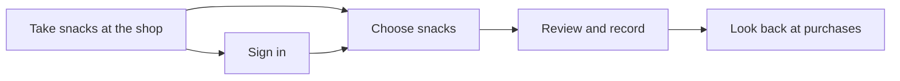

<!-- AGENT-READONLY: machine-generated by /wiki-reindex; do not hand-edit. -->

# Journeys graph

Every `user-journey` page's stages, drawn left to right, with an edge from a stage to each stage its Next leads to; a stage with no Next leads to the next one on the page. Rebuild with `/wiki-reindex`.

## design:journeys/employee-record-a-purchase

