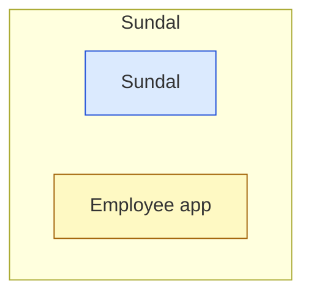

<!-- AGENT-READONLY: machine-generated by /wiki-reindex; do not hand-edit. -->

# Module graph

The product modules and the `depends-on` edges between them. An arrow runs from a module to a module it depends on; a module's features, and its dependencies that are not modules, are in its section below. A level is the build level `/dev-status` reports: 0 for a module that depends on nothing, otherwise one above its deepest dependency, and `—` for a module on a dependency cycle or downstream of one. Rebuild with `/wiki-reindex`.

## `product:modules/sundal`

Sundal · kind `application` · parent — · level 0

- Depends on:
  - none
- Dependents:
  - none
- Features:
  - none

## `product:modules/sundal/employee-app`

Employee app · kind `area` · parent `product:modules/sundal` · level 0

- Depends on:
  - none
- Dependents:
  - none
- Features:
  - `product:features/sundal/employee-app/purchase-log` — Purchase log; depends on `product:features/sundal/employee-app/record-a-purchase`
  - `product:features/sundal/employee-app/record-a-purchase` — Record a purchase
  - `product:features/sundal/employee-app/sign-in` — Sign in
