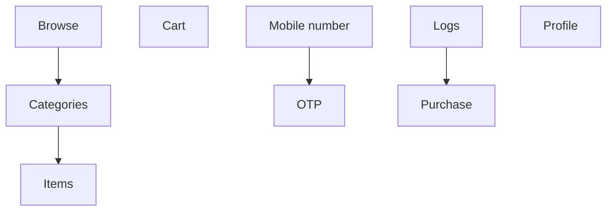

<!-- AGENT-READONLY: machine-generated by /wiki-reindex; do not hand-edit. -->

# Sitemaps graph

The composed sitemap of every `information-architecture` page: its own nodes and those of the pages it includes. An edge runs from a node's Parent to the node, and a dashed edge from each of its Also under parents. Rebuild with `/wiki-reindex`.

## design:information-architecture/employee-app

