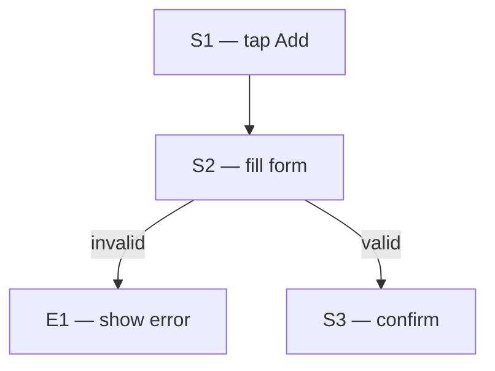

<!-- AGENT-READONLY: This file is generated by the agent-kit deploy.
     Do not edit here. Edit the source in the agent-kit repo and
     re-run deploy. If you find a defect, stop and report it to the developer. -->

<!--
  task-flow — the ordered steps a user takes to complete ONE task. Text-first behavioral contract:
  (a) input to a designer for the visual, (b) the behavioral spec a `test-scenario` page verifies —
  its scenarios map to this flow's step ids, its rows name the flow criteria they verify, and code
  tests cite those scenarios via `@verifies`.
  Lives at: module flow `product/flows/<module>/<kebab-task>.md`; shared flow
    `product/flows/_shared/<kebab-task>.md`, or `product/flows/<deliverable>/_shared/<kebab-task>.md`
    for a base only one deliverable's areas share.
  Authorship: canonical. SLO: 90d.
  Owner: fixed to `product`, do not substitute.
  Distinct from: the visual flow (that lives in a design tool or design file, where one exists); a
    feature (that's the capability and its capability-level acceptance — link it).
  Discipline: `<module>` is the module's path under `product/modules/` — the deliverable (`storefront`)
    or one of its areas (`storefront/catalog`, `storefront/catalog/search`); author the
    `product-module` page first rather than inventing a directory here.
    Each step carries a stable id (S1, S2…; alternates A1, errors E1, anytime actions T1) so a
    `test-scenario`'s rows map back to the step they cover; each acceptance criterion carries a stable
    id AC1, AC2…; one page = one task; shared flows are reusable bases and module flows
    specialize/extend them — when two or more features realize identical steps, extract to a
    `_shared/` base, at the top of `flows/` when it is shared across deliverables or under the
    deliverable when only its areas share it. States lean on the app-ux-resilience /
    app-ux-accessibility standards.
  Columns: Open questions — Question | Owner | Resume condition.
  Blocks: Steps.
  Cells: Steps › (label) — step-marker; Alternate & error paths › (label) — step-marker;
    Anytime actions › (label) — step-marker.
  Excluded: `## Boundaries` → route each by what it is: a delegation → `## Delegated decisions`;
    a rule spanning entities or features → a product `concept` under `policies/`; a statement
    verifiable by exercising this task → `## Acceptance criteria`; behavior belonging to one
    entity → that entity's `## Invariants`; who may act → the access-model `concept`
    (`concepts/access-model.md`), linked from the step it gates. A flow states what it hands to the
    feature author, not what it is not; the product README is canonical (*"`task-flow` carries no
    boundary statement"*) and the routing is otherwise undiscoverable.
  Disposition: keep every header; "None." when empty.
  Substitute: {{TITLE}} {{DATE}} {{CONFIDENCE}} {{ORIGINATION}}.
-->
---
title: {{TITLE}}
type: task-flow
template-version: 1
sources: []
related: []
created: {{DATE}}
updated: {{DATE}}
owner: product
authorship: canonical
origination: {{ORIGINATION}}
confidence: {{CONFIDENCE}}
---

## Task
<!-- One line: the task this flow completes, in the user's words. Link the feature it realizes via
     [[features/<module>/<feature>]] and the actor via [[domain:personas/<slug>]] or [[personas/<slug>]]. Where a step or anytime-action
     is gated by a role/permission, link the access-model ([[product:concepts/access-model]] if authored; otherwise name the role in prose) —
     the persona is who the actor is; the role is what they are permitted to do. The feature's
     acceptance criteria bind this flow alongside its own. Open with the page's lead sentence — see [[_authoring:wiki-authoring-spec#lead-sentence]]. -->

## Preconditions
<!-- State of the world before the flow starts, and how the actor arrives. One bullet each —
     each one is something a tester will have to set up, so state it concretely. -->

## Delta from the shared flow
<!-- One short paragraph: how this flow differs from the shared base it specializes. Common deltas:
     additional columns in the list view, a status indicator, module-specific filters. Link the base
     via [[flows/_shared/<task>]], or [[flows/<deliverable>/_shared/<task>]] for a deliverable's own
     base; the base's acceptance criteria bind this flow too, and this link is what lets a test prove
     them here. -->

## Steps
<!-- The happy path. One numbered step each, every step the same micro-shape:
     **S<n> — <actor action>**
     - **Response** — <what the system does / shows>
     - **States** — <empty / loading / error relevant here — per app-ux-resilience>
     - **Branch** — <condition → alternate id (Ax/Ex), or "—">
     The bold-label bullet is the one per-block bullet form the tree uses ([[_authoring:wiki-template-labels#template-labels]]); a dropped bullet is a `template-bullets` finding, so a step that
     forks nowhere writes `- **Branch** — —` rather than dropping the line.
     Number steps in order and never reuse a number; if you delete one, leave the gap. A step
     inserted later takes the next unused number and sits where it actually runs, so the numbers need
     not read in order down the page. See [[_authoring:wiki-page-ids#row-and-criterion-ids]].
     A step that happens on no product surface carries a marker right after its id —
     `**S2 (system) — <what the system does>**` — `system`, `agent` or `external`; a step on a
     surface carries none, whoever performs it.
     Name entity fields as inline `code` (matching the entity's `## Data model`); the
     ## Task line stays in plain user language. -->

**S1 — <actor action>**
- **Response** — <system response>
- **States** — <empty / loading / error>
- **Branch** — —

## Flow diagram
<!-- Equivalent visual of the Steps — makes the forks graspable at a glance. The numbered Steps
     remain the source of truth (test-scenario rows map to step ids); this diagram MIRRORS them.
     Reuse the same ids as node ids (S1, A1, E1) so the diagram stays traceable and drift is
     obvious — update both together. The labels below are illustrative; replace with your steps.
     GUARDRAIL — no mermaid `[[ ]]` node shape (collides with wiki-links); see [[_authoring:wiki-authoring-spec#presentation-defaults]]. -->

<!-- Rendered export (optional): the designed visual — the diagram above is its in-wiki equivalent.
     Either:
       - an external Figma frame URL, or
       - a _raw image via `[[_raw:flows/<module>/<task>.png]]`, listed in `sources:` as the
         lint-clean anchor for the asset (it satisfies the orphan-_raw check — not a claim the
         page is derived from it). -->

## Alternate & error paths
<!-- The forks the happy path referenced. One labeled block each: **A1 — <condition>** → steps/outcome.
     These are the negative/edge checks. A MUTATING flow must carry at least one write-failure E path
     (save/network failure) — a one-liner referencing the app-ux-resilience standard is enough.
     Two-tier diagram rule: a DOMAIN-error E (a fork the reader must see) is drawn in the Flow diagram;
     the UNIVERSAL save-failure E is listed here in prose but NOT drawn. Both are conformant — an
     undrawn save-failure E is intentional, not a missing node. A/E ids are allocated as step ids are. -->

## Anytime actions
<!-- Status/lifecycle actions reachable at any time, not tied to a happy-path step
     (e.g. cancel, suspend/resume, archive, revoke). Each carries a stable id T1, T2… so a
     test can point back at it. Number in order, never reuse, and leave the gap when you delete one.
     See [[_authoring:wiki-page-ids#row-and-criterion-ids]]. -->

- **T1 — <action>** (<state transition or effect>).

## Postcondition
<!-- Assertion-grade observable outcomes: name what a verifier can observe after the task
     completes, not what the system did internally. Each bullet is a concrete, testable claim.
     ✓  "The campaign appears in the campaign list with status 'Active'."
     ✗  "The campaign was saved." (describes the action, not the observable state)
     One or more bullets. This section becomes the integration test's final assertion.
     Only the main path's end state belongs here; a guarantee that must hold on other paths or
     across repeated runs is an acceptance criterion. -->

## Acceptance criteria
<!-- One `- **AC<n>.** <behavior>` bullet per criterion this flow alone can verify, beyond the end
     state the Postcondition names; for which criteria live here rather than on the feature, see the
     product README draws the line between these and the feature's. Number them in order and never
     reuse a number — tests cite these numbers, and on a shared flow a specializing flow's tests cite
     them too, so reusing one repoints a test at different behavior. Leave the gap when you delete one.
     See [[_authoring:wiki-page-ids#row-and-criterion-ids]].
     Each criterion testable as written and in plain user language. Where a criterion turns on a stored
     value, name the field as inline `code`, matching `feature`; where it describes what the user sees,
     use the label they see. "None." when the flow states no criterion beyond its postcondition. -->

- **AC1.** <behavior that must hold beyond the main path's end state>

## Delegated decisions
<!-- Explicitly records what per-feature authors are delegated to decide — e.g. pagination
     style, default sort order, module-specific empty-state messaging. One bullet per
     delegation decision. Prevents implicit assumptions from silently propagating.
     Not shared-flow-only: a module flow that leaves any call to its feature authors fills this
     too. "None." when the flow settles every decision itself. -->

## Open questions
<!-- Unresolved interaction/scope questions for design or test. One ROW each: what is open, who
     settles it, and the observable state that says it is time to settle it — the register's own
     columns, rather than an inline `deferred | owner | resume` restatement of them.
     "None." when nothing is open. -->

| Question | Owner | Resume condition |
|---|---|---|
| <what is unresolved> | | |
