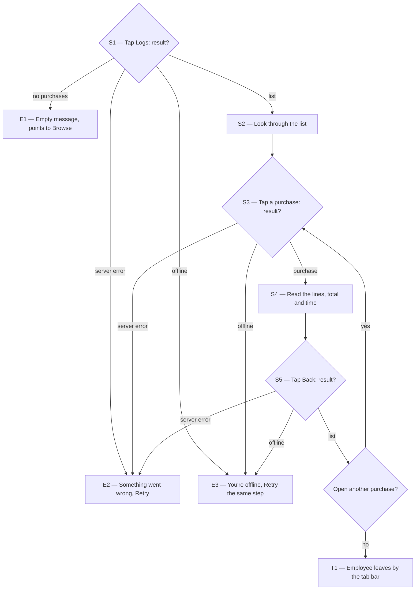

## Task

An employee ([[product:personas/employee]]) finds a purchase they recorded earlier and checks what it holds. This flow realizes [[product:features/sundal/employee-app/purchase-log]].

The employee opens the purchase from the Logs tab. Landing on the same purchase right after recording is step S8 of [[product:flows/sundal/employee-app/record-a-purchase]], not this flow.

## Preconditions

- The employee is signed in on this phone ([[product:flows/sundal/employee-app/sign-in]]).
- The phone is online.
- The employee has recorded zero or more purchases ([[domain:entities/purchase-log]]).

## Delta from the shared flow

None. The project records no shared base flow for this task.

## Steps

**S1 — The employee taps Logs in the tab bar.**
- **Response** — The employee's list of purchases appears with Logs as the selected tab. The cart bar shows only if the cart holds items. Logs always opens on the list, whatever the employee last saw in it.
- **States** — loading, empty, error.
- **Branch** — The employee has recorded no purchase → E1. The server cannot return the list → E2. The phone is offline → E3.

**S2 — The employee looks through the list for the purchase they want.**
- **Response** — Each recorded purchase shows as one row, and only this employee's purchases show.
- **States** — —
- **Branch** — —

**S3 — The employee taps a purchase.**
- **Response** — The purchase opens as the Purchase page, titled "Purchase", with a Back control. It shows one line for each entry, the totals and the time it was recorded. It does not show the "Your purchase has been recorded" confirmation.
- **States** — loading, error.
- **Branch** — The server cannot return the purchase → E2. The phone is offline → E3.

**S4 — The employee reads the lines, the total and the time.**
- **Response** — Each line shows the item's name, its price as shown when the purchase was recorded, the quantity taken and the line's total. The page offers no cancel, edit or void action.
- **States** — —
- **Branch** — The employee wants another purchase → S5.

**S5 — The employee taps Back.**
- **Response** — The list of purchases appears again with Logs still selected.
- **States** — loading, error.
- **Branch** — The employee opens another purchase → S3. The server cannot return the list → E2. The phone is offline → E3.

## Flow diagram

## Alternate & error paths

**E1 — The employee has recorded no purchase.** The list is replaced by a message that says nothing is recorded yet and points to Browse. Nothing else shows.

**E2 — The server cannot return the list or the purchase.** The message block fills the content region with "Something went wrong. Try again." and Retry. Retry asks the server again for the same list or purchase. The flow writes nothing, so there is no save failure.

**E3 — The employee taps something that needs the server while offline.** The offline rules of the employee app apply ([[product:modules/sundal/employee-app]]): "You're offline" with Retry, and Retry repeats the tap. Nothing changes on the server.

## Anytime actions

- **T1 — The employee taps another tab.** The Browse or Profile tab opens on its first screen. Nothing is kept of where the employee was in Logs.
- **T2 — The employee taps the cart bar.** The Cart opens. The cart bar shows on Logs and on the Purchase page only while the cart holds items.
- **T3 — The phone goes offline.** A toast says "You're offline" and nothing else on screen changes ([[product:modules/sundal/employee-app]]).

## Postcondition

- The Purchase page shows one purchase of this employee: each line's item, quantity and price, the total and the time it was recorded.
- The employee's list, their purchases and the stock are unchanged.

## Acceptance criteria

- **AC1.** The list and every purchase in it belong to the signed-in employee. No other employee's purchase is ever shown.
- **AC2.** A line shows the price the employee saw when recording, even if the item's price has changed since ([[product:features/sundal/employee-app/record-a-purchase]] AC4).
- **AC3.** No screen in this flow offers the employee a way to cancel, edit or void an entry.

## Delegated decisions

- The order of the list, and whether a long list loads in parts.
- What each row shows, for example the time, the number of items and the total.
- The wording of the empty message (E1).
- Whether Back returns the employee to the place they had reached in the list.

## Open questions

| Question | Owner | Resume condition |
|---|---|---|
| In what order does the list show purchases, and does a purchase with a voided entry show differently? | Shivani Erlewad | The Purchase log list screen is specified |
| How does a line show when the vendor has voided its entry? The Entry entity has no void state yet. | Shivani Erlewad | The vendor's void screens are designed |
| The record-a-purchase feature lists the Purchase detail surface, and the Purchase log feature opens it too. Which feature lists it? | Shivani Erlewad | The feature pages are written |
| Do employees check past purchases, and how often is a recorded line wrong? | Shivani Erlewad | The vendor has voided entries for some time or employees have been asked |
