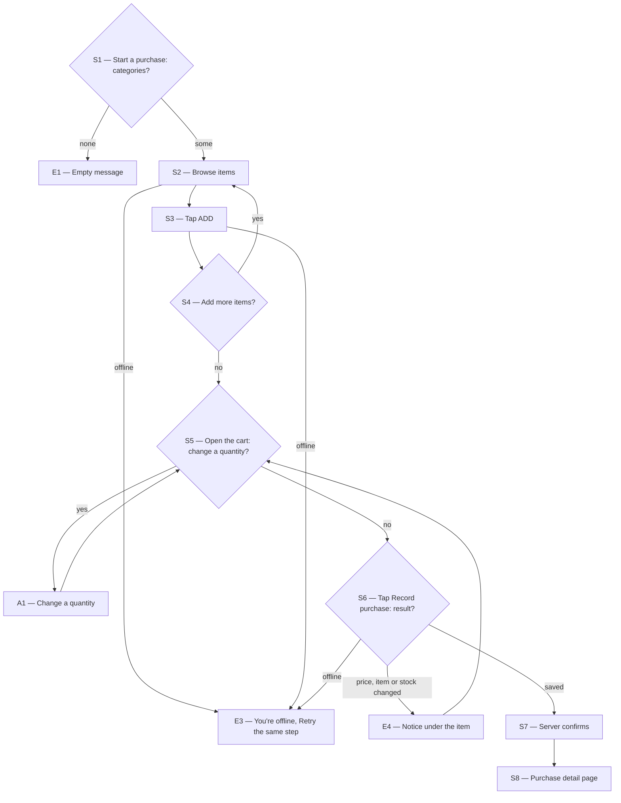

## Task

An employee ([[personas/employee]]) records the snacks they took from the shop on their phone. This flow realizes [[features/sundal/employee-app/record-a-purchase]].

## Preconditions

- The employee is signed in on this phone.
- The vendor's categories, items, prices and stock are available.

## Delta from the shared flow

None.

## Steps

**S1 — The employee starts a purchase.**
- **Response** — The vendor's categories appear. If the cart already has items, the cart bar shows them.
- **States** — loading, empty, error.
- **Branch** — The vendor has added no categories → E1.

**S2 — The employee opens a category and browses its items.**
- **Response** — Each item card shows its image, name, description and price. An item with none left shows "Out of stock" and has no ADD button.
- **States** — loading, empty, error.
- **Branch** — The phone is offline → E3.

**S3 — The employee taps ADD on an item.**
- **Response** — ADD turns into **− 1 +**. + stops at the available stock. The cart bar appears with the item count and total.
- **States** — error.
- **Branch** — The phone is offline → E3.

**S4 — The employee repeats S2 and S3 for each item they want.**
- **Response** — The cart bar updates each time.
- **States** — —
- **Branch** — —

**S5 — The employee taps the cart bar.**
- **Response** — The cart lists each item with its quantity and price, and the total.
- **States** — loading, error.
- **Branch** — The employee changes a quantity in the cart → A1.

**S6 — The employee taps Record purchase.**
- **Response** — The screen shows "Recording…".
- **States** — loading, error.
- **Branch** — A price changed, an item was removed or stock ran short → E4. The phone is offline → E3.

**S7 (system) — The server saves every line and takes the quantities out of stock.**
- **Response** — The server confirms.
- **States** — —
- **Branch** — The server cannot save → E5.

**S8 — The employee lands on the purchase detail page.**
- **Response** — It shows this purchase only, with "Your purchase has been recorded". The cart is empty.
- **States** — loading, error.
- **Branch** — —

## Flow diagram

## Alternate & error paths

**A1 — The employee changes a quantity in the cart.** They use + and −. An item taken to 0 is removed, and an empty cart hides the cart bar.

**E1 — The vendor has not added categories.** The list shows an empty message.

**E3 — The employee taps something that needs the server while offline.** The offline rules of the employee app apply ([[modules/sundal/employee-app]]). Nothing is recorded.

**E4 — A price changed, an item was removed or stock ran short while the cart was open.** This includes items saved from an earlier visit. A notice appears under that item and the quantity is lowered. Nothing is recorded until the employee taps Record purchase again.

**E5 — The server cannot save the purchase.** The screen shows "Something went wrong. Try again." Nothing is recorded. Any other save failure uses this same message.

## Anytime actions

- **T1 — The employee leaves before tapping Record purchase.** Nothing is recorded, and the cart is kept.
- **T2 — The phone goes offline.** The offline rules of the employee app apply ([[modules/sundal/employee-app]]).

## Postcondition

- The purchase detail page shows each line of this purchase with its item, quantity, price, total and time.
- The cart is empty and the cart bar is hidden.

## Acceptance criteria

- **AC1.** The cart bar and Record purchase are visible only when the cart has at least one item.
- **AC2.** The + button stops at the available stock and adds nothing past it.
- **AC3.** An employee who leaves before tapping Record purchase has nothing recorded, and the cart is kept.
- **AC4.** After a notice appears under an item (E4), nothing is recorded until the employee taps Record purchase again.

## Delegated decisions

- The wording that explains why + has stopped at the available stock.
- The wording of the empty message when the vendor has added no categories (E1).
- The wording of the notice under an item when a price, item or stock changed (E4).

## Open questions

None.

