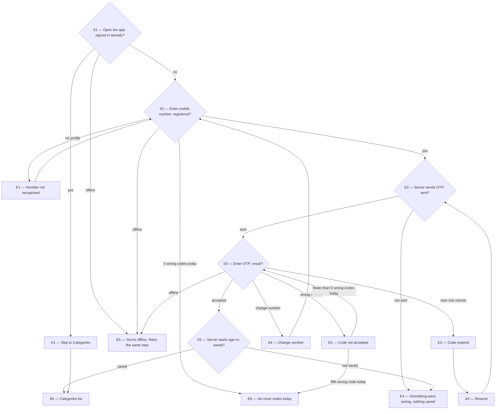

## Task

An employee ([[product:personas/employee]]) signs in to the employee app on their phone with their mobile number and a one-time code. This flow realizes [[product:features/sundal/employee-app/sign-in]].

Record a purchase assumes this flow: its precondition "The employee is signed in on this phone" is met here ([[product:flows/sundal/employee-app/record-a-purchase]]).

## Preconditions

- The employee has a profile: their company admin has added them with their mobile number ([[domain:entities/profile]]).
- The employee is signed out on this phone: they have never signed in on it, they logged out, or another phone's sign-in ended this one.
- The phone is online.

## Delta from the shared flow

None. The project records no shared base flow for sign-in.

## Steps

**S1 — The employee opens the app.**
- **Response** — The mobile number screen appears, with a field for the mobile number and a Continue button. No tab bar and no cart bar show.
- **States** — error.
- **Branch** — The app already keeps the employee signed in → A1. The phone is offline → E5.

**S2 — The employee enters their mobile number and taps Continue.**
- **Response** — The screen shows that the code is being sent, and Continue cannot be tapped again meanwhile.
- **States** — loading, error.
- **Branch** — The number belongs to no profile → E1. The number has already had 5 wrong codes today → E6. The phone is offline → E5.

**S3 (system) — The server sends a six-digit OTP to the mobile number.**
- **Response** — The OTP screen appears. It names the mobile number the code went to.
- **States** — —
- **Branch** — The server cannot send the code → E4.

**S4 — The employee enters the six digits and confirms.**
- **Response** — The screen shows that the code is being checked.
- **States** — loading, error.
- **Branch** — The code is wrong or was already used → E2. More than one minute has passed since the code was sent → E3. The employee taps Change number → A4. The phone is offline → E5.

**S5 (system) — The server accepts the code and starts the employee's sign-in on this phone.**
- **Response** — The code is spent and cannot be used again. Any sign-in the employee had on another phone ends.
- **States** — —
- **Branch** — The server cannot save the sign-in → E4.

**S6 — The employee lands on the Categories list.**
- **Response** — Browse is the selected tab and the tab bar shows. If the employee's cart already holds items, the cart bar shows them.
- **States** — loading, empty, error.
- **Branch** — —

## Flow diagram

## Alternate & error paths

**A1 — The app already keeps the employee signed in.** S1 to S5 are skipped and the employee lands on the Categories list (S6). The app keeps the employee signed in between visits.

**A2 — The employee signs in on a new phone.** The flow is the same as on any phone. At S5 the sign-in on the employee's previous phone ends, because a sign-in is active on one phone at a time. The next time the app opens on the previous phone, it shows the mobile number screen, with no message.

**A3 — The employee taps Resend.** Resend is available one minute after a code was sent, when that code has expired. It sends a new code (S3) and keeps the mobile number filled in.

**A4 — The employee taps Change number.** The mobile number screen opens with the number still filled in. The code already sent is left to expire. The employee corrects the number and taps Continue (S2).

**E1 — The mobile number belongs to no profile.** The screen says the number is not recognised and stays on the mobile number screen. No code is sent. The employee can correct the number and tap Continue again (S2).

**E2 — The code is wrong or was already used.** The screen says the code was not accepted and stays on the OTP screen. The employee can enter the digits again (S4). The fifth wrong code of the day leads to E6.

**E3 — More than one minute has passed since the code was sent.** The screen says the code has expired. The employee taps Resend for a new code (A3).

**E4 — The server cannot send the code or save the sign-in.** The screen shows "Something went wrong. Try again." with Retry. No sign-in starts.

**E5 — The employee taps something that needs the server while offline.** The offline rules of the employee app apply ([[product:modules/sundal/employee-app]]): "You're offline" with Retry. Nothing changes on the server, and the employee stays on the same screen.

**E6 — The number has had 5 wrong codes today.** The screen says no more codes can be tried today. No code is sent and none is accepted until midnight Indian time. The count covers every code sent to the number that day, including Resend.

## Anytime actions

- **T1 — The employee closes the app before S5 completes.** No sign-in starts. Opening the app again starts at S1.
- **T2 — The employee taps Log out on Profile.** The saved sign-in on this phone ends, and the app shows the mobile number screen. The employee's cart stays on their account and shows again at the next sign-in ([[product:features/sundal/employee-app/record-a-purchase]] AC9).
- **T3 — The phone goes offline.** The offline rules of the employee app apply ([[product:modules/sundal/employee-app]]).

## Postcondition

- The Categories list shows with Browse selected, and the tab bar is visible.
- The app opens on the Categories list at the employee's next visit, without asking for the mobile number, until the employee logs out or signs in on another phone.
- The code the employee used cannot sign anyone in again.
- Profile shows the employee's own picture, name and mobile number.

## Acceptance criteria

- **AC1.** A code works for one minute from when it is sent and for one sign-in only ([[domain:entities/otp]]).
- **AC2.** After an employee signs in on a second phone, the first phone is signed out and opens on the mobile number screen.
- **AC3.** While the employee is offline at any step, nothing changes on the server and no sign-in starts.
- **AC4.** After 5 wrong codes in a day, no code is sent to that mobile number and none is accepted until midnight Indian time.
- **AC5.** Resend is not available until one minute after the code was sent.

## Delegated decisions

- The wording of the not-recognised message (E1), the code-not-accepted message (E2), the expired-code message (E3) and the message at the limit (E6).
- The wording of the line that says where the code was sent (S3).
- How Resend shows while it is not yet available.
- Whether the mobile number field takes a country code or a ten-digit Indian number.

## Open questions

None.